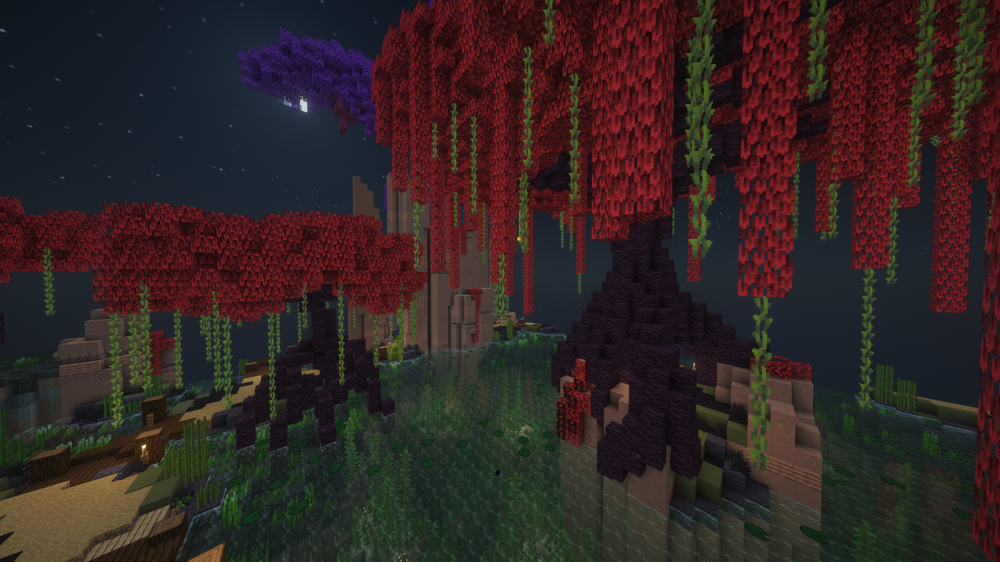
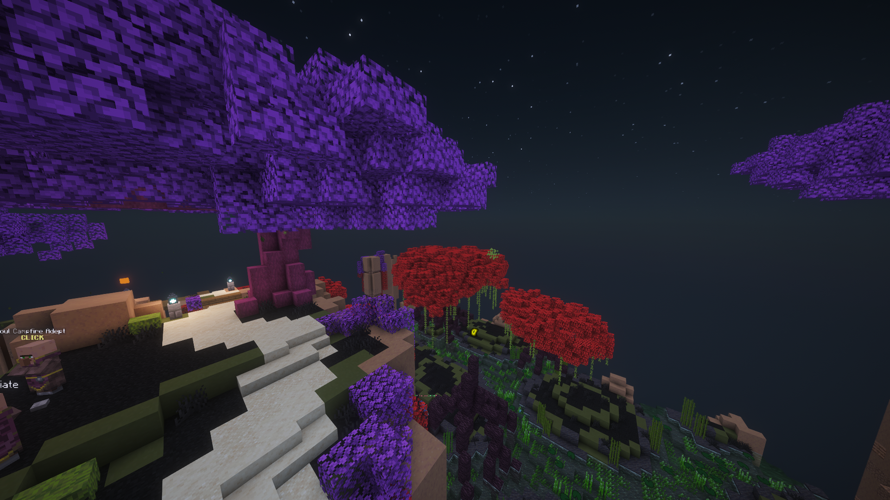
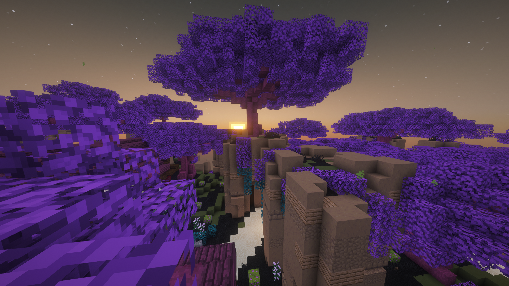

# Custom Moonglade Marsh (Catharsis pack)

A configurable recolour pack for Galatea / Moonglade Marsh in Hypixel SkyBlock (`/locraw` mode `foraging_2`). It requires the [Catharsis](https://modrinth.com/mod/catharsis) mod, version 1.0.0-beta.22 or newer.





## Options
Open the options in-game with `/catharsis config moonglade_marsh`.

| Section | Option | Applies to |
|---|---|---|
| Fig Trees | Wood Type (11 woods, default Spruce) | spruce and stripped spruce logs and wood in the fig tree areas |
| Fig Trees | Leaf Color (Default + 13 colours) | azalea and flowering azalea leaves anywhere on the island, plus other leaf types in the fig tree areas |
| Mangrove Trees | Wood Type (default Mangrove) | mangrove and stripped mangrove logs and wood in the mangrove tree areas |
| Mangrove Trees | Leaf Color | mangrove leaves anywhere on the island, plus other leaf types in the mangrove tree areas |
| Grass & Paths | Grass Color | grass blocks, short and tall grass, ferns, vines and lily pads |
| Grass & Paths | Path Color (Default + 13 colours) | dirt paths, the starting-area sand, sandstone slabs and stairs, and oak slabs; full sandstone blocks are left alone because buildings use them |
| Grass & Paths | Vegetation Follows Grass Color (on by default) | moss, cave vines, azalea bushes, dripleaf, seagrass, kelp, sugar cane, propagules, sea pickles, berry bushes, olive ground blocks (green terracotta) and hedge leaves outside the tree areas also use the grass colour |
| Grass & Paths | Water Color (Default + 13 colours) | water on Moonglade Marsh |
| Marsh Clutter | Hide Grass & Ferns, Hide Lily Pads | anywhere on the island; hitboxes are unchanged |
| Time of Day | Sky: Server Time / Sunrise / Day / Sunset / Night | locks the sun, moon, stars, sky, fog, clouds and sky lighting |
| Time of Day | Sky Applies To: Moonglade Marsh Only / All of SkyBlock | where the chosen sky is used; All of SkyBlock covers every island skyblock-api knows, including the hub, dungeons, the Garden and the Rift |
| Ground | Mud Texture | mud blocks |

The Time of Day option only changes what your client draws. The server's time, mob spawning and anything else that depends on real time stay the same. The values are taken from the vanilla overworld `day` timeline, so each preset matches vanilla at that time. Shader packs may calculate their own sky and ignore these values.

## How it is scoped
- Every replacement is wrapped in an `in_island: foraging_2` condition, so other islands are never affected.
- The tree areas (`moonglade_marsh:fig_trees` and `moonglade_marsh:mangrove_trees`) are Catharsis's built-in `catharsis:galatea/fig` and `catharsis:galatea/mangrove` boxes, widened by 4 blocks on each side, 3 below and 4 above. The original boxes cut through canopies.
- A replacement whose condition fails falls through to the next pack, so other Catharsis packs, such as Torrhus Canyon, keep working.

## Compatibility
The pack has been run on Minecraft 26.2. Catharsis beta.22 also exists for 26.1.x and 26.3, so it should work there, but that is untested.

## Install
Download the pack zip, put it in `.minecraft/resourcepacks`, and enable it.

## Building
The pack in `Moonglade Marsh/` is generated. To rebuild it:

```bash
python -I tools/build_pack.py <dir containing assets/minecraft and data/minecraft extracted from the 26.2 client jar>
python -I tools/validate_pack.py "Moonglade Marsh" <same dir>
```

`tools/sky_time.py` evaluates the vanilla day timeline (`data/minecraft/timeline/day.json` together with the overworld dimension type) at a given tick. Running `python -I tools/sky_time.py <dir> 6000 18000` prints the noon and midnight values.

The build needs Python with Pillow. It reads the Galatea tree areas from your local Catharsis repo cache (`%APPDATA%/.minecraft/catharsis-repo-cache/areas/galatea`). The build writes the zip to the repository root; the zip is git-ignored.

## Credits
The textures are recoloured from vanilla Minecraft textures (© Mojang). This project is not affiliated with Hypixel, Mojang or the Catharsis authors.
